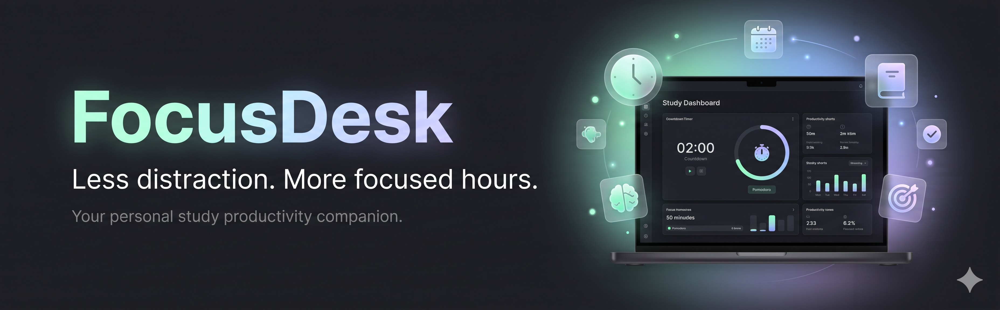

  

 

# 🎯 FocusDesk

### Less distraction. More focused hours.

A fun little vibe-coded project built to make studying, tracking time and staying consistent a little easier.

FocusDesk brings study timers, subject tracking, study goals and productivity insights together in one place. No complicated setup, just a simple space to focus and keep track of your progress.

 

---

### 🚀 Try It Live

  

---

### ✨ What Can It Do?

| Feature | Description |
|:---|:---|
| ⏱️ **Study Timer** | Countdown timer and stopwatch to track focused sessions. |
| 📚 **Subject Tracking** | See how much time you spend on each subject. |
| 📝 **Study Notes** | Add optional notes about what you studied. |
| ☕ **Break Management** | Manage short and long study breaks. |
| 📊 **Dashboard** | Get a quick overview of your study progress. |
| 📅 **Study History** | Look back at your previous study sessions. |
| 📈 **Analytics** | Explore daily, weekly and monthly study patterns. |
| 🎯 **Study Goals** | Set daily and weekly targets. |
| 🌙 **Dark Theme** | A clean interface for comfortable study sessions. |
| 💾 **Local Storage** | Designed to keep your study data on your computer. |

 

---

### 🛠️ Made With

**Technologies & Tools**

  

 

**AI Tools**

  
  &nbsp;
  
  &nbsp;
  

---

### 💻 Platform

Designed with **Windows 11** in mind, with an offline-first approach.

---

### 💡 Why I Made This

I wanted a simple way to track my study hours, see where my time goes and stay consistent with my learning goals.

So, I started building FocusDesk. Just an idea, some AI-assisted coding and a lot of experimenting!

---

### 🚧 Just for Fun

This is a personal **vibe-coding project**, built for learning, experimenting and making something useful along the way.

It's still evolving, and there's always something new to improve.

 

---

  <b>Made with curiosity, code and a little AI magic. ✨</b>
    
  ⭐ If you find it interesting, give it a star!

